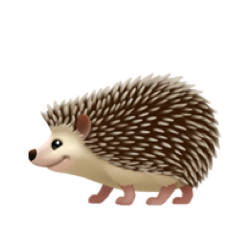

# Welcome to Nixham 

Nixham (_/ˈnixəm/_) is a small hamlet containing Nix stuff that hasn't yet been absorbed by Greater Nixester.

## Geography

- `modules/`
  - `nixos/` - NixOS modules. Available under `modules.nixos`
  - `nix-darwin/` - `nix-darwin` modules. Available under `modules.nix-darwin`
- `packages/` - Nix packages. Available under `packages.${platform}`
- `profiles/` - compositions of modules and packages for my systems.

## History

- I build a lot of custom modules and packages for my systems.
- I don't want to wait for nixpkgs / nix-darwin / home-manager, and I don't want to maintain a permanent fork
- I sometimes have experimental modules that I don't want to upstream, this is a home for them
